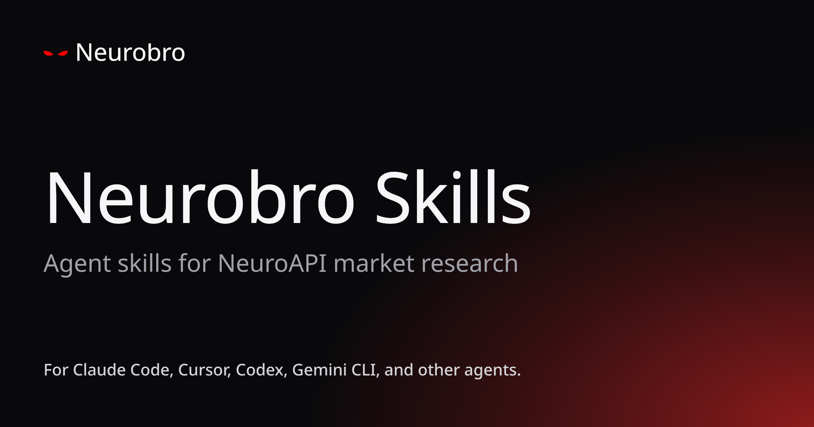

<p align="center">
  
</p>

<h1 align="center">Neurobro Skills</h1>

<p align="center">
  <a href="https://neuroapi.neurobro.ai"></a>
  <a href="LICENSE"></a>
</p>

Agent skills for **[NeuroAPI](https://neuroapi.neurobro.ai)**, the crypto and financial market research API by Neurobro. Install them in Claude Code, Cursor, Codex, Gemini CLI, or any agent that reads skills, and your agent can ask about any coin, stock, or macro trend and get a researched answer back.

Each skill teaches the agent to call NeuroAPI correctly: which `mode` to pick, how to handle quota and rate limits, and how to write prompts that return useful research.

[Get an API key](https://neuroapi.neurobro.ai/signup) or [read the docs](https://neuroapi.neurobro.ai/docs).

## Skills

| Skill | What your agent can do |
| --- | --- |
| [`neurobro-market-research`](skills/neurobro-market-research/) | Research crypto, stocks (US, Indonesia, Brazil, Vietnam), commodities, and macro through the NeuroAPI agent. |
| [`neurobro-meme-hunting`](skills/neurobro-meme-hunting/) | Find trending and newly launched memecoins and check their risk: scam flags, mint and freeze authority, holder concentration, buy and sell pressure, age, and liquidity. |
| [`neurobro-trading-setup`](skills/neurobro-trading-setup/) | Build structured trade setups for crypto, stocks, and commodities, with entry zones, stop-loss, take-profit targets, and risk/reward. |
| [`neurobro-catalyst-watch`](skills/neurobro-catalyst-watch/) | Map upcoming catalysts (earnings, FOMC and macro prints, token unlocks, launches, listings, regulatory decisions), check what is priced in, and plan around the event. |

Every skill name starts with `neurobro-`, and more are added over time.

## Install

With the [`skills`](https://www.skills.sh) CLI, for any supported agent:

```bash
npx skills add axioma-ai-labs/neurobro-skills
```

Or as a Claude Code plugin:

```bash
/plugin marketplace add https://github.com/axioma-ai-labs/neurobro-skills
/plugin install neurobro-market-research@neurobro-skills
```

## Setup

1. [Create an API key](https://neuroapi.neurobro.ai) in the NeuroAPI dashboard under **API Keys**. Keys look like `neuro_<random>`, and the full key is shown once.
2. Make sure the account has an active plan. Without one, `/agent/ask` returns `403 no_active_subscription`.
3. Give the agent the key through the `NEUROAPI_API_KEY` environment variable:

   ```bash
   cp .env.example .env        # then edit .env and set NEUROAPI_API_KEY
   export NEUROAPI_API_KEY="neuro_..."
   ```

`.env` is git-ignored, so your key is never committed. `.env.example` is the template and holds no secret.

## Plans and modes

The skills call `POST /agent/ask`, and each successful call debits `cost_units` from your monthly quota.

| Mode | Cost | What it's for | Plans |
| --- | --- | --- | --- |
| `fast` | 1 unit | Quick answers with core market knowledge | All |
| `smart` (default) | 2 units | Deeper reasoning for analysis and trade setups | All |
| `max` | 8 units | Deep multi-asset investigations | Pro, Enterprise |

Starter is $49 a month for 10,000 units, Pro is $299 a month for 100,000 units, and Enterprise starts at 1,000,000 units. Details are on the [pricing page](https://neuroapi.neurobro.ai/docs/pricing).

## MCP

The same research is also available as an MCP tool:

```text
https://api.neurobro.ai/api/v1/mcp
```

It speaks Streamable HTTP and exposes one tool, `ask_neuroapi`. Send your key in the `X-API-Key` header. On this endpoint only, `Authorization: Bearer` also works. The REST API does not accept it. Never put the key in the URL.

Setup for Claude Code, Cursor, VS Code, and Claude Desktop is in [Connect a client](https://neuroapi.neurobro.ai/docs/mcp/clients). Field details are in [the endpoint reference](skills/neurobro-market-research/references/endpoints.md#mcp). For runnable Python examples, see the [NeuroAPI Cookbook](https://github.com/axioma-ai-labs/neuroapi-cookbook).

NeuroAPI answers are AI research, not financial advice. They can be wrong, and you decide what to do with them.

## Repo layout

```
.claude-plugin/      Claude Code plugin marketplace manifests
.github/workflows/   CI: validates every SKILL.md on push
agents/              Shared context for non-Claude agents (Codex, Gemini)
scripts/             validate-skills.mjs, the frontmatter checker
skills/              One directory per skill, each with a SKILL.md
```

## Contributing

New skills are welcome. See [CONTRIBUTING.md](CONTRIBUTING.md).

## License

MIT. See [LICENSE](LICENSE).
